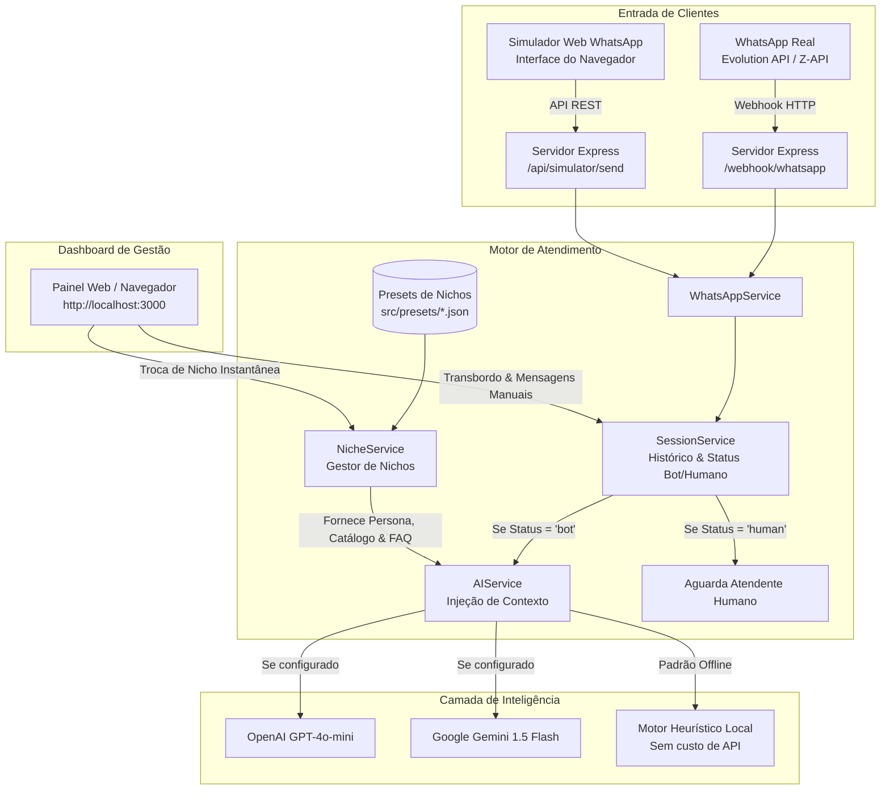

# 🏛️ Arquitetura do Sistema - AutoAtendimento Multi-Nicho

Este documento explica como o sistema foi concebido para permitir que qualquer empresa ou nicho (clínica odontológica, distribuidora de bebidas, imobiliária, etc.) utilize o mesmo motor de inteligência e atendimento.

---

## 📐 Diagrama de Fluxo e Componentes



---

## 📁 Estrutura de Pastas

```text
automatic-atendimento/
├── public/                 # Painel Web & Simulador do WhatsApp
│   ├── index.html          # Interface do simulador e abas de gestão
│   └── app.js              # Lógica do chat, envio e chamadas de API
├── src/
│   ├── presets/            # Nichos pré-configurados em JSON
│   │   ├── dentista.json
│   │   ├── distribuidora.json
│   │   ├── imobiliaria.json
│   │   └── template_custom.json
│   ├── routes/
│   │   ├── api.ts          # Endpoints do simulador, nichos e sessões
│   │   └── webhook.ts      # Receptor de mensagens do WhatsApp real
│   ├── services/
│   │   ├── aiService.ts    # Montagem de prompts e inferência de IA
│   │   ├── nicheService.ts # Carregamento e troca de nicho ativo
│   │   ├── sessionService.ts # Gestão de conversas e transbordo humano
│   │   └── whatsappService.ts # Orquestrador de mensagens
│   └── server.ts           # Entrada principal da aplicação Express
├── package.json
├── tsconfig.json
├── .env.example
├── WORKFLOW.md             # Regras obrigatórias de Git para a equipe
└── README.md               # Guia de início rápido
```

---

## 🔌 Conexão com Provedores Reais de WhatsApp
O endpoint `POST /webhook/whatsapp` já está preparado para receber mensagens da:
1. **Evolution API**: Reconhece o evento `messages.upsert`.
2. **Z-API**: Reconhece payloads com `phone` e `text`.
3. **Meta WhatsApp Cloud API**: Suporta a verificação de handshake `hub.challenge`.
